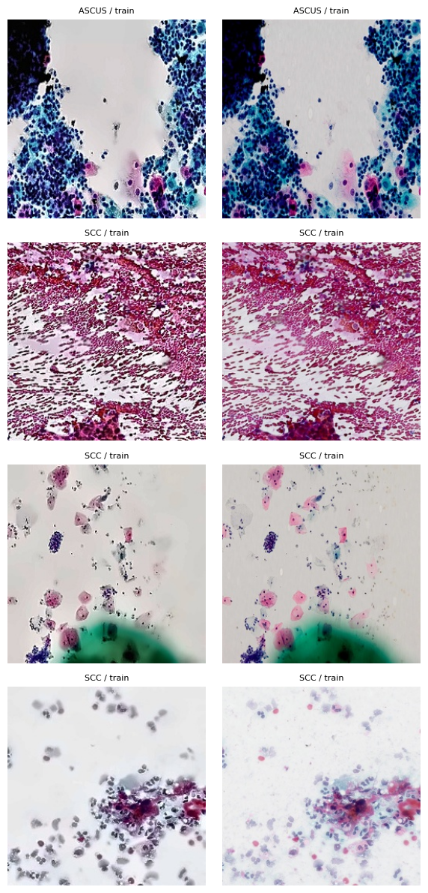
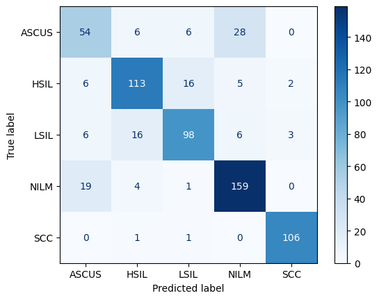
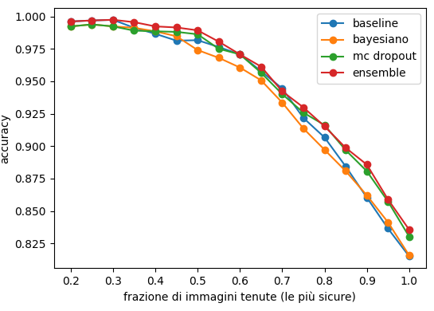

# Cervical Cancer: classificazione di immagini citologiche con reti bayesiane

Classificazione a 5 classi (`ASCUS`, `HSIL`, `LSIL`, `NILM`, `SCC`) di immagini di citologia cervicale. Il progetto addestra una ResNet50 come baseline e la confronta con tre approcci che stimano l'incertezza — **ultimo layer bayesiano**, **MC Dropout** e **ensemble** — valutando non solo l'accuratezza ma anche **calibrazione** (ECE), **NLL** e capacità di separare gli errori con l'incertezza.

Progetto personale, sviluppato come notebook Kaggle.

## Risultati in breve

- **Modello migliore: ensemble di 3 ResNet50**, con **accuracy 0.836** e **F1 macro 0.829** sul test set.
- **La calibrazione cambia molto più dell'accuratezza.** L'ensemble ha ECE **0.020**, il layer bayesiano **0.023**, ma la baseline 0.079 e MC Dropout 0.084. Tutti i modelli stanno tra 0.815 e 0.836 di accuracy: la differenza vera è nella confidenza che dichiarano.
- **Il layer bayesiano è il compromesso migliore**: 0.816 di accuracy con **ECE 0.023**, addestrando solo 2048 → 5 parametri sulle feature estratte, non l'intera rete.
- **L'incertezza separa bene gli errori.** Sul test, entropia media 0.365 sulle previsioni corrette contro 0.955 sulle sbagliate (ensemble); 0.446 contro 1.000 per il modello bayesiano.
- **ASCUS è la classe difficile** (F1 0.60–0.62), confusa soprattutto con NILM: sul validation 28 dei suoi 40 errori finiscono lì. SCC è quasi risolta (F1 0.97).
- Il dataset conteneva **leakage tra gli split**: la deduplica con perceptual hash e lo split per gruppi lo hanno eliminato prima del training.

## Dataset

- Fonte: [Cervical Cancer Image Largest Dataset](https://www.kaggle.com/datasets/robiulhasan21/cervical-cancer-image-largest-dataset) (Kaggle). 7.341 immagini in 5 cartelle, una per classe: ASCUS 1.100, HSIL 1.550, LSIL 1.454, NILM 2.101, SCC 1.136.
- **Deduplica.** Prima per MD5 sui file con dimensione ripetuta: le copie identiche con etichetta in conflitto vengono scartate, le altre ridotte a una sola. Restano **6.620** immagini.
- **Split 70 / 10 / 20** stratificato (seed 42) → 4.634 train, 662 validation, 1.324 test.
- Immagini portate a **256×256** (JPEG quality 95) e poi a 224 in rete. Il resize serve a rendere trattabile il calcolo dei perceptual hash e il training.
- **Seconda deduplica, sui quasi-duplicati.** pHash a 64 bit su tutte le 6.620 immagini ridotte, distanza di Hamming tra tutte le coppie: **360 coppie** con al massimo 4 bit di differenza, di cui **147 a cavallo di split diversi** (leakage) e **6 con etichette diverse**. Le coppie sono unite in gruppi con le componenti connesse, i gruppi con etichette in conflitto vengono rimossi e lo split è rifatto **per gruppi**: `StratifiedGroupKFold` a 10 fold, fold 0–1 test, fold 2 validation, fold 3–9 train.
- **Dataset finale: 6.608 immagini** — 4.638 train, 656 validation, 1.314 test. Nessun gruppo compare in più di uno split (verificato: 0).



*Quattro coppie di quasi-duplicati trovate con pHash, affiancate: a sinistra e a destra della riga la stessa immagine ricompressa o rifilata, con la classe e lo split di provenienza nel titolo. Da qui è emerso che 147 coppie cadevano a cavallo di split diversi, cioè il leakage che lo split per gruppi elimina.*

| Classe | Train | Validation | Test |
|---|---|---|---|
| ASCUS | 682 | 94 | 185 |
| HSIL | 987 | 142 | 276 |
| LSIL | 945 | 129 | 268 |
| NILM | 1.240 | 183 | 365 |
| SCC | 784 | 108 | 220 |

Il dataset non è incluso nel repository. Il download da Kaggle via API ha restituito una sola classe, quindi il notebook è stato eseguito dentro una **Kaggle Notebook**, con il dataset montato in `/kaggle/input`.

## Struttura del repository

```
bdl-project.ipynb   notebook unico, con i blocchi nell'ordine di esecuzione
output/             figure e metriche esportate
```

Il notebook è organizzato in blocchi:

| # | Blocco | Contenuto |
|---|---|---|
| 1 | Inventario dati | montaggio di `/kaggle/input`, conteggio file per cartella ed estensione |
| 2 | Deduplica MD5 | hash sui file con dimensione ripetuta, rimozione copie e conflitti, split 70/10/20 |
| 3 | Resize | immagini a 256×256 in parallelo, percorsi salvati in `path_small` |
| 4 | Quasi-duplicati | pHash, distanze di Hamming, ispezione visiva delle coppie |
| 5 | Split per gruppi | componenti connesse, rimozione dei gruppi in conflitto, `StratifiedGroupKFold` |
| 6 | DataLoader | `Dataset`, trasformazioni train/eval, pesi di classe |
| 7 | Baseline | ResNet50, fine-tuning in due fasi, curva di loss, report sul validation |
| 8 | Tuning | griglia learning rate × weight decay con label smoothing |
| 9 | Estrazione feature | backbone del modello migliore con `fc = Identity()` → 2048 dimensioni |
| 10 | Layer bayesiano | `BayesLinear`, training variazionale, 50 campioni di pesi |
| 11 | Analisi incertezza | matrice di confusione, scomposizione aleatoria/epistemica, IC 95% |
| 12 | MC Dropout | testa con dropout 0.5, 50 forward pass |
| 13 | Ensemble | 3 ResNet50 con seed diversi |
| 14 | Confronto | calibrazione e curva di rifiuto sul validation |
| 15 | Test set | stesse quattro stime sul test, tabella finale di metriche |

## Come eseguire

Il notebook è pensato per **Kaggle Notebook** (GPU): i percorsi `/kaggle/input`, `/kaggle/working` e il device `cuda` sono cablati nel codice. In locale servirebbe riscrivere quei percorsi e scaricare il dataset a mano.

Dipendenza extra rispetto all'ambiente Kaggle standard:

```bash
pip install -q imagehash
```

Le celle vanno eseguite **in ordine**: ogni blocco legge i CSV prodotti dal precedente e salva i pesi in `/kaggle/working` (`resnet50.pt`, `ens_0.pt` … `ens_2.pt`). Il calcolo dei pHash (matrice di distanze tra tutte le coppie) e i training delle ResNet sono i passaggi più onerosi.

## Metodologia

1. **Pulizia prima di tutto.** Due passaggi di deduplica: hash MD5 per le copie esatte, pHash per le immagini ricompresse o rifilate. Il secondo passaggio ha rivelato 147 coppie a cavallo degli split, cioè leakage reale: sarebbe bastato uno split casuale per gonfiare le metriche di validation.
2. **Split per gruppi, non per immagine.** `StratifiedGroupKFold` mantiene ogni gruppo di quasi-duplicati in un solo split, e mantiene le proporzioni tra classi.
3. **Augmentation solo in training**: `RandomResizedCrop(224, scale=(0.6, 1.0))`, flip orizzontale e verticale, normalizzazione ImageNet. In valutazione resize diretto a 224×224 senza casualità — anche per estrarre le feature del train, altrimenti il layer bayesiano vedrebbe feature distribuite diversamente.
4. **Classi sbilanciate.** `CrossEntropyLoss` con pesi `N / (5 · n_c)` calcolati sul train: 1.36 per ASCUS, 1.18 per SCC, 0.94 per HSIL, 0.98 per LSIL, 0.75 per NILM.
5. **Metrica di selezione: F1 macro**, non l'accuratezza — con le classi sbilanciate l'accuratezza nasconde il crollo di ASCUS. Il checkpoint salvato è quello con F1 macro migliore sul validation.

### Baseline: ResNet50 in due fasi

| Fase | Cosa si addestra | Epoche | Ottimizzatore |
|---|---|---|---|
| 1 | solo il nuovo `fc` (2048 → 5) | 3 | AdamW, lr 1e-3, wd 1e-4 |
| 2 | tutta la rete | 10 | AdamW, lr 1e-4, wd 1e-4 |

La fase 1 porta il validation da 0.620 a 0.657 di accuracy; la fase 2 sale a **0.809 / F1 0.802**. La curva di loss (fase 2 dalla linea tratteggiata) non mostra overfitting marcato entro le 10 epoche.

Sul validation:

| Classe | Precision | Recall | F1 | Support |
|---|---|---|---|---|
| ASCUS | 0.617 | 0.617 | 0.617 | 94 |
| HSIL | 0.820 | 0.803 | 0.811 | 142 |
| LSIL | 0.815 | 0.752 | 0.782 | 129 |
| NILM | 0.804 | 0.852 | 0.828 | 183 |
| SCC | 0.964 | 0.981 | 0.972 | 108 |
| **macro avg** | **0.804** | **0.801** | **0.802** | 656 |

Il tuning su learning rate (3e-5, 1e-4, 3e-4) e weight decay (1e-4, 1e-2) con label smoothing 0.1, 8 epoche per combinazione, non ha prodotto guadagni proporzionati al costo computazionale: la griglia è rimasta lì.

### I tre approcci all'incertezza

Tutti e tre partono dalle **2048 feature** estratte dalla baseline migliore, così il confronto isola il metodo di incertezza e non la capacità del backbone.

**1. Ultimo layer bayesiano.** `BayesLinear(2048, 5)` con media e `rho` come parametri, pesi campionati come $w = \mu + \mathrm{softplus}(\rho)\cdot\varepsilon$. Prior $N(0, 0.05^2)$ invece della $N(0,1)$ standard: con 2048 input una prior troppo larga domina la verosimiglianza e il posterior collassa verso la prior. Loss = cross-entropy + `kl_weight · KL`, con `kl_weight = 1/N` (approssimazione della ELBO sul dataset intero). 100 epoche, Adam lr 5e-3, batch 256. In previsione, 50 campioni di pesi: la media delle softmax è la previsione, la dispersione è l'incertezza. σ media appresa sui pesi: **0.048**, coerente con la prior.

**2. MC Dropout.** Testa `Dropout(0.5)` + `Linear(2048, 5)`, 100 epoche, Adam lr 1e-3. In previsione il dropout resta attivo (`head.train()`): 50 forward pass diversi.

**3. Ensemble.** 3 ResNet50 con seed 0, 1, 2, 8 epoche ciascuna da ImageNet, media delle softmax.

### Scomposizione dell'incertezza

Sui 50 campioni di pesi del modello bayesiano:

```
entropia totale   H  = −Σ p̄ log p̄                 incertezza della previsione media
aleatoria         A  = media su campioni di −Σ p_s log p_s    rumore nei dati
epistemica        E  = H − A                        ignoranza del modello
```

## Calibrazione e curve di rifiuto

Diagrammi di affidabilità a 10 bin e curva di rifiuto, calcolati sia sul validation sia sul test (la versione sul test è nella sezione Figure). La curva di rifiuto è il test più utile in ambito clinico: dice quanta accuratezza si guadagna rinviando a un secondo giudizio una quota di casi.

## Risultati sul test set

| Modello | Accuracy | F1 macro | ECE | NLL | Incert. corrette | Incert. sbagliate |
|---|---|---|---|---|---|---|
| Baseline | 0.815 | 0.808 | 0.079 | 0.566 | 0.182 | 0.701 |
| Bayesiano | 0.816 | 0.808 | **0.023** | 0.510 | 0.446 | 1.000 |
| MC Dropout | 0.830 | 0.821 | 0.084 | 0.656 | 0.143 | 0.588 |
| **Ensemble** | **0.836** | **0.829** | **0.020** | **0.448** | 0.365 | 0.955 |

- L'**ensemble** vince su accuratezza, F1, NLL e ECE, al costo di tre training completi.
- Il **layer bayesiano** ottiene lo stesso F1 della baseline con ECE tre volte più basso e NLL migliore, addestrando un solo strato lineare: è il risultato più efficiente del progetto.
- **MC Dropout** guadagna accuratezza (0.830) ma **peggiora la calibrazione** (ECE 0.084) e il NLL (0.656): è il caso interessante, perché mostra che un modello più accurato può essere meno affidabile nella confidenza dichiarata.
- La colonna "incertezza su previsioni sbagliate" è sempre molto più alta di quella sulle corrette: l'entropia è utilizzabile come segnale di rinvio per tutti e quattro i modelli.

## Figure

**Quasi-duplicati.** La figura è nella sezione Dataset: mostra quattro coppie affiancate tra le 360 trovate, ed è la prova visiva del leakage corretto prima del training.

**Matrice di confusione, modello bayesiano — validation, 656 immagini.**



*ASCUS è la classe che si perde: 54 corretti su 94, con 28 letti come NILM. Lo scambio è simmetrico — 19 NILM vengono classificati ASCUS — mentre le altre coppie si confondono per 6–16 immagini. NILM è la classe più stabile (159 su 183), SCC quasi perfetta (106 su 108). L'errore non è rumore diffuso ma uno scambio tra due classi adiacenti per definizione.*

**Curva di rifiuto sul test — 1.314 immagini.**



*Accuratezza tenendo solo la frazione più sicura delle immagini, ordinate per entropia. L'ensemble resta sopra gli altri per tutta la curva e il divario si allarga nella coda incerta (attorno al 90% di immagini tenute la distanza dalla baseline è di alcuni punti), ma l'ordine dei modelli è lo stesso che si vede in tabella: il vantaggio dei metodi bayesiani sta nella confidenza dichiarata, non nel ranking dei casi dubbi. Il pannello di calibrazione corrispondente è saltato perché con 10 bin su 1.314 immagini i punti sono troppo rumorosi per essere letti.*

Le altre figure in `output/` (curva di loss, matrice di confusione della baseline, intervalli di confidenza, diagrammi di affidabilità) restano come materiale di supporto. Attenzione: `confronto ECE modelli.png` è la versione sul **validation** (ECE 0.085 / 0.045 / 0.109 / 0.029), non quella sul test citata nella tabella qui sopra.

## Limiti

- Dataset da un'unica fonte, 5 classi con confini citologici discussi anche tra esperti: ASCUS e LSIL si sovrappongono per definizione, e il modello eredita l'ambiguità delle etichette invece di risolverla.
- Le etichette non sono state validate da un citologo all'interno del progetto, e non c'è un test set esterno: le metriche valgono per questa distribuzione.
- L'ensemble è di soli 3 modelli e 8 epoche ciascuno, per contenere il costo su Kaggle.
- La linear probing sul backbone congelato limita il modello bayesiano: l'incertezza è stimata sulle feature della baseline, non su una rete addestrata con obiettivo bayesiano.
- La soglia di quasi-duplicati (4 bit su 64) è una scelta prudente ma arbitraria; con una soglia più alta il dataset si ridurrebbe ulteriormente.

## Possibili estensioni

- Sostituire la linear probing con **variazionale sull'intera rete** (o LoRA bayesiano) per separare incertezza epistemica del backbone da quella della testa.
- **Temperature scaling** sulla baseline per isolare quanto dell'ECE dipende dalla calibrazione post-hoc e quanto dal metodo bayesiano.
- Spostare la decisione sulla **curva di rifiuto** con una soglia di entropia, invece di classificare sempre: quantificare quanti casi inviare a revisione e quanto accuracy si guadagna.
- Riportare le metriche per classe con intervalli di confidenza bootstrap, dato che ASCUS ha solo 185 immagini di test.
